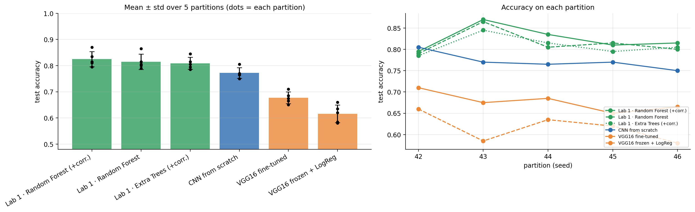
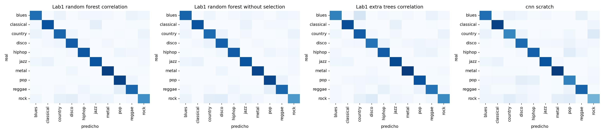
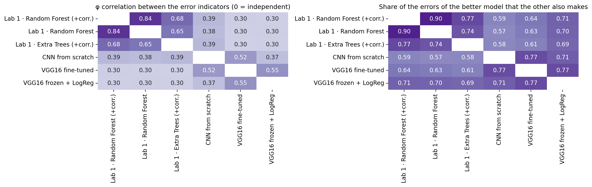
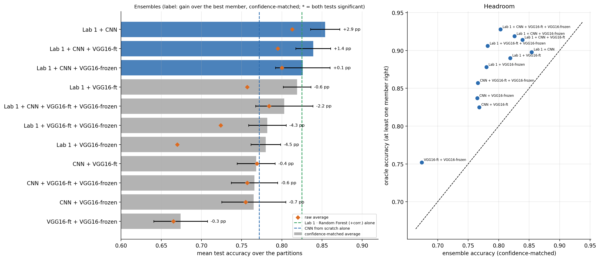
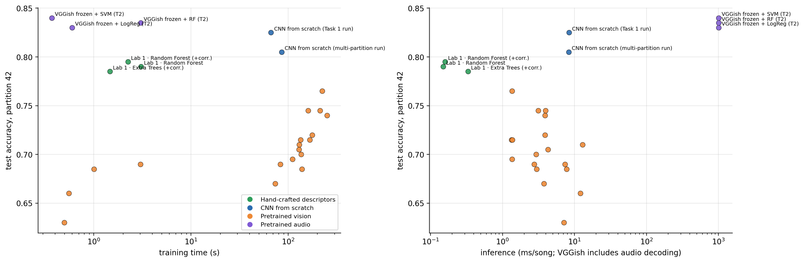
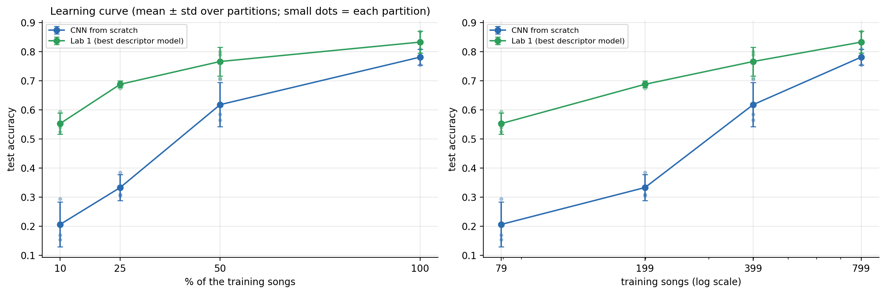
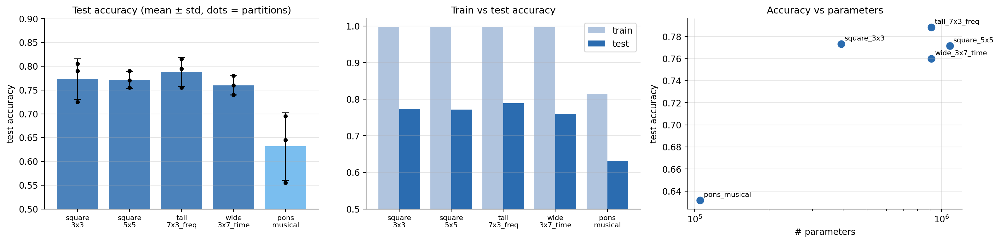
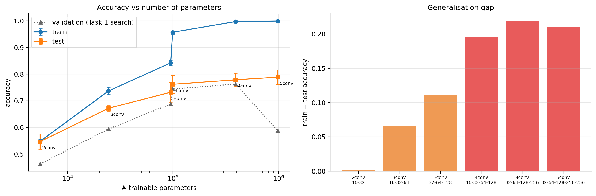
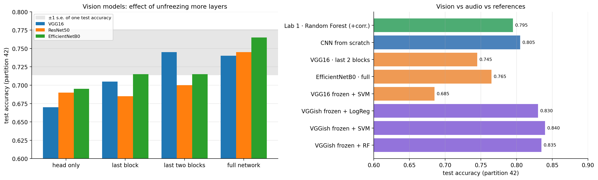

# Lab 2 – Music Genre Classification with CNNs

**Machine Learning for Sound and Music · Lab 2** · Anna Casanovas Poirier

Genre classification on GTZAN (10 genres, 999 songs of 30 s) comparing three families of models on **exactly the same songs**:

1. **Hand-crafted descriptors** (Lab 1: MFCCs, chroma, spectral features, … + tree ensembles),
2. **A CNN trained from scratch** on mel-spectrogram images (Task 1),
3. **Pretrained models** (VGG16 / ResNet50 / EfficientNetB0 fine-tuned, plus VGG16 and VGGish frozen embeddings + classical classifiers) (Task 2).

The full write-up, with every table, figure and statistical test, is in [`Documentation.pdf`](Documentation.pdf). This README summarises it and explains how to navigate and reproduce the repository.

Lab 1 repository (descriptors, preprocessing and models): <https://github.com/annacp04/music-genre-classification>

---

## TL;DR – main findings

Test accuracy over **5 different 80/20 song-level partitions** (seeds 42–46, same test songs for every model), mean ± SD:

| Model | Family | Accuracy | Macro-F1 |
|---|---|---|---|
| Random forest + correlation filter (Lab 1) | Descriptors | **0.825 ± 0.029** | 0.822 |
| Random forest (Lab 1) | Descriptors | 0.815 ± 0.029 | 0.813 |
| Extra trees + correlation filter (Lab 1) | Descriptors | 0.809 ± 0.023 | 0.806 |
| CNN from scratch (Task 1) | Learned features | 0.772 ± 0.020 | 0.768 |
| VGG16 fine-tuned (last 2 blocks) | ImageNet pretrained | 0.677 ± 0.023 | 0.674 |
| VGG16 frozen + logistic regression | ImageNet pretrained | 0.616 ± 0.034 | 0.617 |
| Descriptors + CNN, confidence-matched soft voting | Ensemble | **0.854 ± 0.018** | – |

Main partition only (seed 42, one run, exploratory): VGGish frozen embeddings + SVM reach **0.840**, the best single model on that split, but the difference with the descriptors (0.795) is not significant.

1. **Learned features do not beat descriptors here** (Q1). The CNN is 5.3 pp below the best descriptor model, a difference that is *not* statistically significant; pretrained ImageNet networks are clearly below.
2. **One split is not enough** (Q5). Accuracy moves by 5.5–8 pp between partitions; the CNN is 1st on seed 42 and 4th on the other four. Only differences of ≈ 7 pp or more can be detected on a single 200-song test set.
3. **The approaches are complementary** (Q2, Q3). Errors overlap only partly (φ = 0.39); averaging descriptor and CNN probabilities (after matching their confidence scales) gives +2.9 pp and wins on all 5 partitions.
4. **Cost** (Q4). The random forest trains in 2.7 s and predicts in 0.19 ms/song; the CNN is ≈ 22× more expensive and the fine-tuned VGG16 ≈ 47×, for lower accuracy.
5. **Pretraining** (Q9, Q10). Fine-tuning beats frozen ImageNet features by 5.5–7.5 pp, but still stays below the scratch CNN. The *audio* model (VGGish) is the best pretrained starting point.

---

## Repository structure

```
.
├── task_1.ipynb                # Task 1: CNN from scratch – preprocessing, 16-config search, final model
├── task_2.ipynb                # Task 2: fine-tuning (3 nets × 4 strategies), frozen embeddings, VGGish
├── lab1_retraining.ipynb       # Lab 1 pipelines retrained on the shared split (CV selection, 5 partitions)
├── multiseed_retraining.ipynb  # Final models on 5 partitions; kernel-shape (Q7) and depth (Q8) sweeps
├── analysis.ipynb              # Comparison of all models + research questions Q1–Q10
├── Documentation.pdf           # Report: methods, results, discussion
├── split_seed42.json           # Main 80/20 partition (list of song IDs)
├── training_logs.json          # Logs of all Task 2 runs
├── results_task1/              # Task 1 outputs: search table, final model, test predictions
├── results_task2/              # Task 2 outputs: runs.csv, test probabilities, embeddings, config
└── results_lab2/               # Shared outputs of the comparison
    ├── splits/                 #   the 5 partitions (seeds 42–46)
    ├── preds/                  #   per-song test predictions of every model and seed
    ├── history/                #   training curves of every CNN run
    ├── models/                 #   trained scratch-CNN checkpoints (.keras)
    ├── figures/                #   figures q1…q10 used in the report
    ├── error_analysis/         #   per-model confusion/calibration/error-taxonomy tables and plots
    └── table_*.csv, appendix_*.csv, key_numbers.json   # every table of the report
```

| Folder / file | Where it is used in `Documentation.pdf` |
|---|---|
| `results_task1/task1_experiments.csv`, `task1_final.csv` | Table 2, Table 3, §3.3 |
| `results_task2/runs.csv`, `results_lab2/appendix_C_task2_runs.csv` | Table 7, Table 8, Table 24 |
| `results_lab2/lab1_cv_table_seed42.csv`, `appendix_A_lab1_cv.csv` | Table 11, Table 25 |
| `results_lab2/table_all_models_primary.csv` | Table 26 |
| `results_lab2/table_pairwise_mcnemar.csv` | Tables 15, 27 |
| `results_lab2/table_error_overlap.csv` | Table 17 |
| `results_lab2/table_ensembles.csv` | Table 20 |
| `results_lab2/table_cost.csv`, `costs.csv` | Table 21 |
| `results_lab2/learning_curve_*.csv` | Table 22 |
| `results_lab2/table_kernels*.csv`, `table_depth.csv` | Q7 / Q8 (see below) |

---

## Data

The data is **not** stored in the repository (`data/` is git-ignored). It comes from the course Drive folder:
<https://drive.google.com/drive/folders/1ijzsLkkSZHZW2JDaoH2fAm6f9IwMg8dk>

| Item | Used for |
|---|---|
| `images_original/` (mel-spectrogram PNGs, 432×288 RGBA) | Tasks 1 and 2 |
| `genres_original/` (WAV) | VGGish embeddings |
| `features_30_sec.csv` | Lab 1 descriptors (58 non-constant columns) |

The spectrogram set has **999 songs** (jazz has 99 clips).

**Spectrogram preprocessing.** Crop the figure frame (box (55, 37)–(387, 250)) → RGB → bilinear resize to 128×192 (scratch CNN) or 160×240 (pretrained nets) → per-channel standardisation with *training-song* statistics only.

**Partitions.** Song-level 80/20 split stratified by genre (799 train / 200 test). Model selection uses a validation split carved from the training songs (Task 1: 160 songs, Task 2: 80 songs) or 10-fold stratified group CV (Lab 1); the test set is never used to choose hyper-parameters. Seed 42 is the main partition; seeds 42–46 are used to measure split-to-split variability. All partitions are stored as song-ID lists (`split_seed42.json`, `results_lab2/splits/`).

---

## Methods

### Task 1 – CNN from scratch (Keras)
Stack of blocks *Conv3×3 → BatchNorm → ReLU → MaxPool2×2*, then global average pooling, dropout and a 10-way dense layer. AdamW (wd 1e-4), cosine LR from 1e-3 over 40 epochs, batch 32, SpecAugment-style frequency/time masking.

16 configurations were compared on the validation split (depth/filters, dropout, augmentation, LR, kernel shape, input size). Selected: **4 blocks (32-64-128-256), dropout 0, augmentation on, 128×192 input, 391,946 parameters** → **0.825** test accuracy in the Task 1 notebook (Wilson 95 % CI 0.766–0.871), 0.805 in the multi-partition pipeline; GPU non-determinism makes single runs differ by 2–3 pp.

### Task 2 – Pretrained models
- **Vision (ImageNet):** VGG16, ResNet50, EfficientNetB0 at 160×240; two-phase training (head with LR 1e-3, then unfreeze the last layers with LR 1e-5, BatchNorm frozen). 4 strategies × 3 networks = 12 configurations (head only / last block / last two blocks / full network).
- **Frozen embeddings + classical ML:** VGG16 (512-d) and VGGish (256-d: mean + std of 128-d embeddings over time) with logistic regression, SVM (RBF) and random forest.
- **Audio:** VGGish (TF-Hub, cannot be fine-tuned, so used frozen; single partition, exploratory). CLAP was not tested.

### Lab 1 models retrained on the shared split
21 classifier × feature-selection pipelines tuned with 10-fold CV on the training songs only; the two best (random forest and extra trees with a correlation filter) are refitted and evaluated once on the test set, then repeated on the five partitions with fixed hyper-parameters.

### Statistics
Wilson intervals for single accuracies; exact McNemar test (paired, same 200 songs); Nadeau–Bengio corrected resampled t-test over the 5 partitions; Holm correction for multiple comparisons. A difference is called *established* only when both tests agree and the winner is better on most partitions.

---

## Results by research question

| # | Question | Answer (short) | Evidence |
|---|---|---|---|
| Q1 | Do learned features beat descriptors? | **No.** RF 0.825 vs CNN 0.772 (n.s.), VGG16-ft 0.677, VGG16 frozen 0.616. On seed 42 alone the CNN (0.805) and VGGish (0.84) look better, but not significantly. | `figures/q1_*` |
| Q2 | Same mistakes? | **Partly.** 20.4 shared errors vs 7.9 expected by chance (φ = 0.39); oracle accuracy 0.898; 72 song–partition pairs failed by all four models vs 5 expected. Genre-confusion structure only partly shared (Spearman 0.50): descriptors mix classical/jazz and pop/reggae, the CNN mixes pop with disco/rock/hip-hop. Rock is hardest for all. | `figures/q2_*`, `error_analysis/` |
| Q3 | Complementary? | **Yes, partially.** Confidence-matched soft voting RF + CNN: 0.854 ± 0.018 (+2.9 pp, better on 5/5 partitions; borderline after Holm). A plain average fails (0.813) because forest vote fractions and softmax outputs have different scales. | `figures/q3_*` |
| Q4 | Is the extra cost worth it? | **Not for accuracy.** RF: 2.7 s train, 0.19 ms/song, 15 MB. CNN: 58.7 s (21.5×), 4.3 ms (22×), 1.6 MB. VGG16-ft: 127 s (47×), 8.1 ms, 59 MB. | `figures/q4_*`, `table_cost.csv` |
| Q5 | How much does one split tell you? | **Little.** Range 5.5–8 pp across partitions, equal to the binomial noise of 200 songs; ranking depends on the partition; ≈ 7 pp needed for significance with ~40 discordant songs. | `figures/q5_*`, `table_detectable_difference.csv` |
| Q6 | Data size? | The gap RF − CNN is 34.7 pp at 10 % data, 14.8 pp at 50 % and 5.2 pp at 100 %; RF flattens, the CNN is still rising (but its curve is confounded with the number of optimisation steps). | `figures/q6_learning_curves.png` |
| Q7 | Photo-like or musical kernels? | Square 3×3 = 0.773, 5×5 = 0.772, tall 7×3 (freq.) = 0.788, wide 3×7 (time) = 0.760, **Pons-style musical = 0.632** (105 k params, under-fits: train 0.81). Rectangular/5×5 kernels are indistinguishable from 3×3; the musical-kernel network is worse (−14 pp, p = 0.025, Holm 0.10). | `figures/q7_kernels.png`, `table_kernels*.csv` |
| Q8 | Depth and parameters? | Test accuracy rises 0.547 → 0.672 → 0.732 → 0.762 → 0.778 → 0.788 for 5.5 k → 24 k → 95 k → 99 k → 392 k → 983 k parameters; gains are < 2 pp beyond 4 blocks. The train–test gap grows from ≈ 0 (2 blocks) to ≈ 0.22 (4+ blocks): overfitting starts around 4 blocks / ~100 k parameters. | `figures/q8_depth_params.png`, `table_depth.csv` |
| Q9 | Does fine-tuning help? Vision vs audio? | Fine-tuning improves each ImageNet net by 5.5–7.5 pp over its frozen head, but VGG16-ft remains 9.5 pp below the scratch CNN. VGGish (audio) is the best pretrained starting point (0.83–0.84 vs ≤ 0.765). | `figures/q9_*` |
| Q10 | Frozen embeddings + classical ML or fine-tuning? | Depends on pretraining domain. VGG16: fine-tuning wins (0.745 vs 0.63–0.69) but costs 50–320× more training time. VGGish: frozen + SVM is the best option (0.840, 0.4 s training). | `figures/q10_*` |

### Selected figures











---

## How to reproduce

The notebooks were developed on **Google Colab (GPU runtime)** with Google Drive mounted.

| Notebook | Open in Colab |
|---|---|
| `task_1.ipynb` | [](https://colab.research.google.com/github/annacp04/lab2-ML-music-classification/blob/main/task_1.ipynb) |
| `task_2.ipynb` | [](https://colab.research.google.com/github/annacp04/lab2-ML-music-classification/blob/main/task_2.ipynb) |
| `lab1_retraining.ipynb` | [](https://colab.research.google.com/github/annacp04/lab2-ML-music-classification/blob/main/lab1_retraining.ipynb) |
| `multiseed_retraining.ipynb` | [](https://colab.research.google.com/github/annacp04/lab2-ML-music-classification/blob/main/multiseed_retraining.ipynb) |
| `analysis.ipynb` | [](https://colab.research.google.com/github/annacp04/lab2-ML-music-classification/blob/main/analysis.ipynb) |

1. Copy the dataset folders from the Drive link above and this repository into your Drive. The notebooks expect the project folder at `/content/drive/MyDrive/MSC/music-genre-classification-2` and the spectrograms copied to `/content/data/images_original`; **edit the path constants at the top of each notebook** if yours differ.
2. `lab1_retraining.ipynb` reuses the Lab 1 code (`Preprocessing`, `Models`, `grid_config`), so clone the Lab 1 repository first: `git clone https://github.com/annacp04/music-genre-classification`.
3. Run in this order: `lab1_retraining` → `task_1` → `task_2` → `multiseed_retraining` → `analysis`. The shared outputs (splits, predictions, tables, figures) are written to `results_lab2/`.

**Requirements:** Python 3, TensorFlow/Keras (the notebooks print the versions in use), `tensorflow_hub` (VGGish), scikit-learn, SciPy, pandas, NumPy, Matplotlib, Pillow. Seeds for Python, NumPy and TensorFlow are fixed, but GPU kernels are not fully deterministic (same CNN config and seed gave 0.800–0.825 on the same partition), so differences of 2–3 pp between single runs should not be interpreted.

---

## Limitations

- **200 test songs:** one song = 0.5 pp; the 5 partitions overlap in their training sets, so the corrected t-test has little power and "not significant" does not mean "equivalent".
- **Selection on seed 42:** hyper-parameters were chosen on the main partition and kept on the others, so seed-42 values are slightly optimistic and test songs of the other seeds partly overlap with songs used for selection. This affects all models equally.
- **Task 2 selection:** the best of 12 configurations was chosen on an 80-song validation set (optimistic: VGG16 drops from 0.745 to 0.710 on the same partition in the multi-partition pipeline, and to 0.677 on average).
- **Inputs:** the CNNs see 8-bit colour-mapped PNGs, not the underlying log-mel matrices.
- **VGGish** was run on a single partition and could not be fine-tuned; **CLAP** was not tested.
- **GTZAN issues:** repeated songs/artists and some mislabelled clips; splits are by song, not by artist, which can favour memorisation. Conclusions apply to this small-data setting.
- Training times mix CPU (forests) and GPU (networks) and exclude feature/spectrogram extraction.

---

## References

- Tzanetakis & Cook. *Musical genre classification of audio signals.* IEEE TSAP, 2002 (GTZAN).
- Pons et al. *Experimenting with musically motivated convolutional neural networks.* CBMI, 2016.
- Hershey et al. *CNN architectures for large-scale audio classification.* ICASSP, 2017 (VGGish).
- Simonyan & Zisserman. *Very deep convolutional networks for large-scale image recognition.* ICLR, 2015 (VGG).
- Nadeau & Bengio. *Inference for the generalization error.* Machine Learning, 2003 (corrected resampled t-test).
